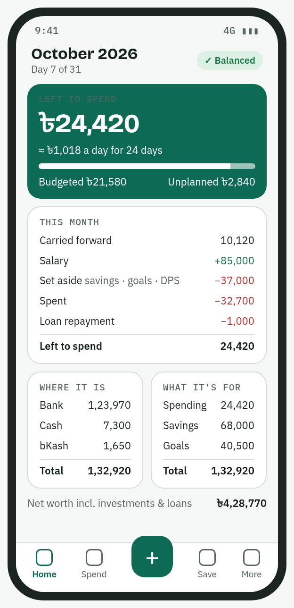
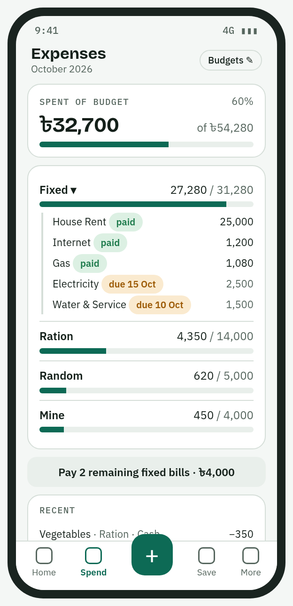
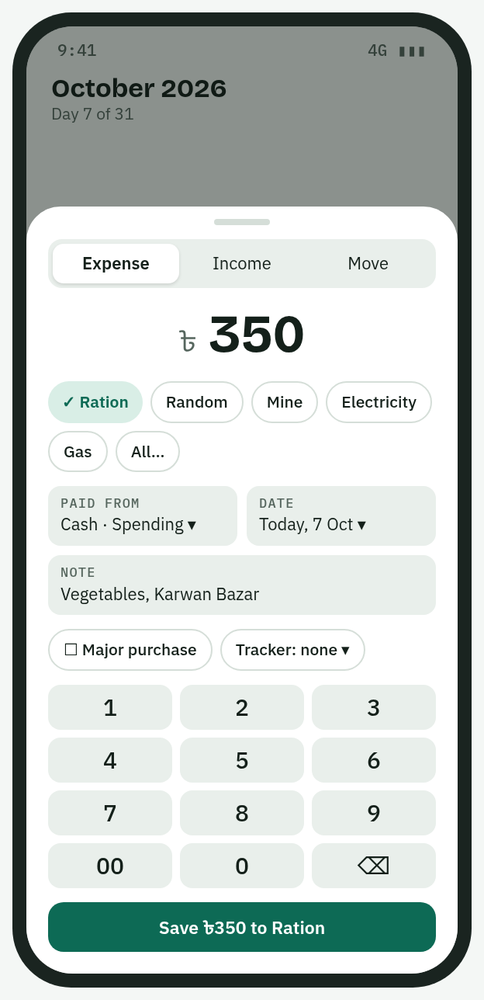
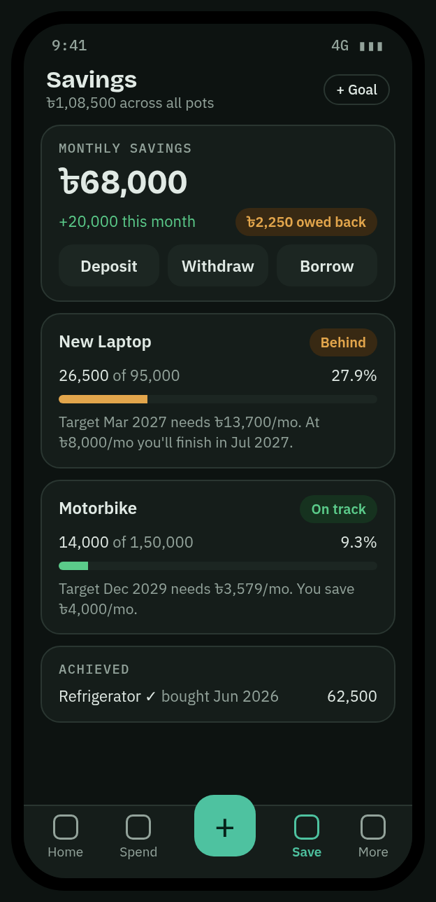

# My Fin Tracker

A personal finance app for Android, built with Flutter. It tracks spending, budgets, savings, goals, loans and salary in Bangladeshi taka. It works offline: all data stays in a SQLite database on the phone, with no account, no server and no analytics. Moving to a new phone uses a backup file.

<p>
  
  
  
  
</p>

<sub>Screen designs from <code>design/</code>; the app follows them closely.</sub>

## Features

- **Accounts and pots.** Every taka has a place (bank, cash, bKash) and a purpose (Spending, Monthly Savings, a goal). Balances are always computed from entries, never typed in.
- **Budgets.** Each category has a monthly budget, and sections can have subsections. Fixed bills have due days. Slots and budget moves change one month without touching the plan.
- **Salary plan.** Records regular incomes and how each salary is split. Salary that arrives on the 26th can be held until the 1st.
- **Savings and goals.** Goals have a target and a date, and the app shows whether you are on track.
- **Loans.** Borrow from your own savings (with a charge, 5% by default), or record loans with people.
- **Month end.** Closing a month saves unused budgets to linked pots and splits the leftover across savings and goals.
- **Insights.** The app compares each category with the same days of last month.
- **Receipt photos.** Attach a receipt to any expense. Backups include the photos.
- **SMS suggestions** (opt-in). The app reads City Bank and bKash messages on the phone and offers each payment as a prefilled entry.
- **Tools.**
  - *Can I afford it?*
  - A zakat calculator with your own zakat date, a projection to that date, and today's gold and silver price on request.
  - A simplified Bangladesh income tax estimate for the July–June year, both for the full year and for income up to today. Its slabs are editable, and it shows every step.
- **Also included:**
  - Cash drawer with note counting
  - Match balance
  - Investments (DPS, FDR, savings certificates)
  - Buying register with warranties
  - Project and countdown trackers
- **Reports.** Monthly and annual PDF reports, and a CSV export for Excel.
- **Backup.** Backups are `.mft` files with a SHA-256 check. The app also makes one automatically each week.
- **Comfort.**
  - App lock (fingerprint or PIN)
  - Home-screen widget and app shortcut
  - Light, dark and pitch-black themes in three colours
  - Lakh grouping (৳1,23,456)

For how to use the app, see the [user manual](docs/user-manual.html).

## Tech stack

| | |
|---|---|
| UI | Flutter (Material 3), [go_router](https://pub.dev/packages/go_router) |
| State | [Riverpod 3](https://pub.dev/packages/flutter_riverpod) |
| Storage | [Drift](https://pub.dev/packages/drift) (SQLite), schema version 5 with tested upgrades |
| Reports | [pdf](https://pub.dev/packages/pdf), [printing](https://pub.dev/packages/printing) |
| Platform | Android only (tested on a Galaxy S24) |

Money is stored as integer poisha. Each entry is written as postings on (account, pot) pairs, which always balance.

## Getting started

Requirements: Flutter 3.47 or newer (Dart 3.13), the Android SDK, and JDK 21 for Gradle.

```bash
flutter pub get
dart run build_runner build     # regenerate lib/data/database.g.dart after schema changes
flutter run                     # debug build installs as "My Fin (dev)"
```

Debug builds use the application ID suffix `.dev`. That lets the dev app and the release app live side by side with separate data.

### Tests

```bash
flutter analyze
flutter test
```

The tests cover:

- the ledger logic
- backups and restores
- database upgrades, starting from the old schemas in `test/fixtures/`
- report generation
- widget tests that draw every screen at Galaxy S24 size (384 × 832 dp) in light and dark themes

### Release build

Signing reads `android/key.properties`, which is not in the repository:

```properties
storePassword=…
keyPassword=…
keyAlias=…
storeFile=/absolute/path/to/your-release.jks
```

```bash
flutter build apk --release --split-per-abi
adb install -r build/app/outputs/flutter-apk/app-arm64-v8a-release.apk
```

> **Install updates with `adb install -r`. Never uninstall first:** uninstalling deletes the app's data. Keep the keystore safe, because updates must be signed with the same key.

## Project layout

```
lib/
  app/        theme, router, providers, app lock, widget, shortcuts, automatic backup
  core/       money (poisha, lakh formatting) and calendar months
  data/       Drift database, repositories, backup, receipts, SMS inbox channel
  ledger/     pure logic: balances, budgets, loans, insights, reminders, tax, zakat, SMS parsing
  features/   one folder per screen (home, spend, save, plan, tools, sms, …)
  reports/    PDF and CSV reports
  ui/         shared widgets and form helpers
test/         unit, upgrade and widget tests; fixtures/ holds old schemas
docs/         user manual and UAT checklist
design/       screen designs and the original plan
android/      Android project; MainActivity.kt holds the SMS channel
```

## Privacy

- The app goes online for one thing only: when you tap **Get today's price** on the Zakat screen. It then fetches the public gold and silver price list from [currency-api](https://github.com/fawazahmed0/exchange-api) and sends nothing about you. Nothing else uses the network.
- Backups leave the phone only when you share them.
- SMS access is off by default. When it is on, messages are read on the phone only, and only from the senders you choose.

## Status

This is a personal project in active use, and changes are tested by hand with [docs/UAT-checklist.md](docs/UAT-checklist.md). The tax and zakat tools give estimates only. Check current rates with NBR and ask a scholar about your own zakat.
